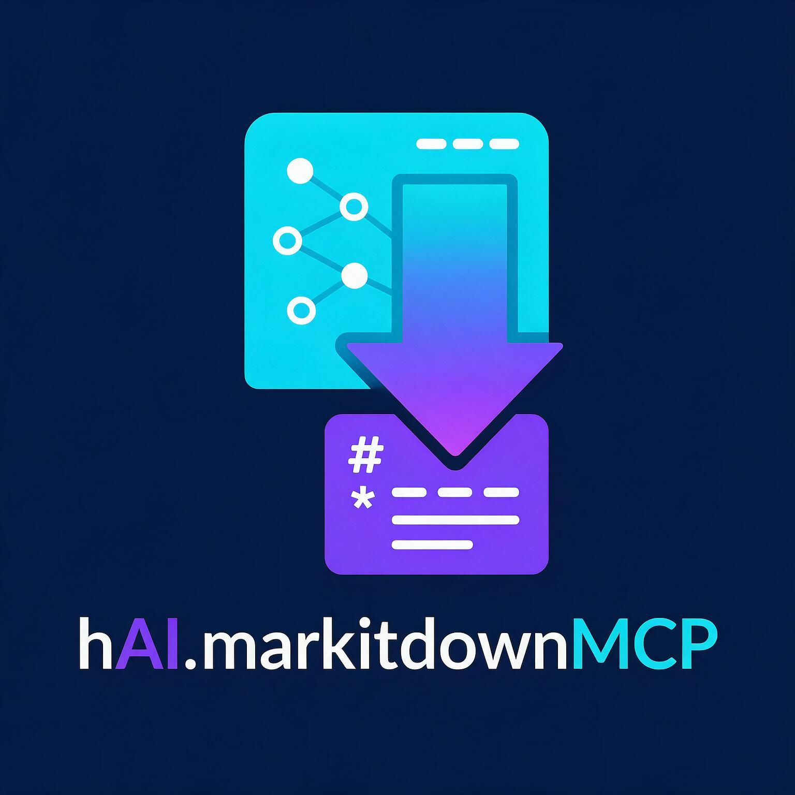

# hAI · MarkItDown MCP

> MarkItDown MCP Server als Portainer Stack für das `highfishNetwork` – Konvertiert PDFs, Office-Dokumente, Bilder, Audio und Webseiten in Markdown für KI-Clients.



---

## Inhalt

- [Überblick](#überblick)
- [Features](#features)
- [Schnellstart](#schnellstart)
- [Docker-Deployment](#docker-deployment)
- [Zugriff](#zugriff)
- [Netzwerk](#netzwerk)
- [Sicherheit](#sicherheit)
- [CI/CD](#cicd)
- [GHCR](#ghcr)
- [Update-Check](#update-check)
- [Technologie](#technologie)
- [Lizenz](#lizenz)

---

## Überblick

**hAI · MarkItDown MCP** ist ein MCP (Model Context Protocol) Server basierend auf Microsofts [`markitdown-mcp`](https://github.com/microsoft/markitdown). Er ermöglicht die Konvertierung verschiedener Dateiformate in Markdown, die nahtlos in KI-Clients integriert werden kann.

### Supported Formate

- 📄 **PDFs** – Dokumente mit Layout- und Formatierungserhalt
- 📝 **Office-Dokumente** – Word, Excel, PowerPoint
- 🖼️ **Bilder** – JPEG, PNG, GIF, WebP, SVG
- 🎵 **Audio** – MP3, WAV, OGG, M4A
- 🌐 **Webseiten** – HTML, URLs mit inhaltsbasiertem Markdown
- 📋 **Textdateien** – Klartext, CSV, JSON

---

## Features

- ✅ **Multi-Format-Support** – Konvertiert 10+ Formate in Markdown
- ✅ **Containerisiert** – Optimiert für Docker/Portainer-Deployments
- ✅ **MCP-kompatibel** – Nahtlose Integration in KI-Clients
- ✅ **CI/CD** – Automatischer Docker-Build per GitHub Actions
- ✅ **GHCR** – Docker-Images in GitHub Container Registry
- ✅ **HighFish-Netzwerk** – Integration in bestehende Infrastruktur
- ✅ **Automatisierte Updates** – Tägliches Prüfen auf neue Upstream-Versionen

---

## Schnellstart

### Lokal installieren

```bash
# Repository klonen
git clone https://github.com/jbkunama1/hAI.markitdownMCP.git
cd hAI.markitdownMCP

# Docker-Image bauen
docker build -t hai-markitdownmcp .

# Container starten
docker run -d \
  -p 3333:3001 \
  --name hai-markitdownmcp \
  -v markitdown-data:/app/data \
  hai-markitdownmcp
```

### Testen

```bash
# Container-Logs prüfen
docker logs hai-markitdownmcp

# Konvertierung testen (wenn MCP-Client verbunden)
curl http://localhost:3333/health
```

---

## Docker-Deployment

### Mit docker-compose (empfohlen)

```bash
docker compose up -d
```

Die Konfiguration im `docker-compose.yml` bindet Port 3333 nach außen und stellt sicher, dass der Server auf `0.0.0.0:3001` läuft.

### Manuell

```bash
docker run -d \
  -p 3333:3001 \
  -e MARKITDOWN_HOST=0.0.0.0 \
  -e MARKITDOWN_PORT=3001 \
  -v markitdown-data:/app/data \
  --name hai-markitdownmcp \
  ghcr.io/jbkunama1/hai-markitdownmcp:latest
```

### In Portainer

**Schritt 1 – Stack aus dem Repository anlegen**

1. Portainer → **Stacks** → **Add stack**
2. **Name:** `hai-markitdownmcp`
3. **Build method:** **Repository**
4. - **Repository URL:** `https://github.com/jbkunama1/hAI.markitdownMCP.git`
   - **Ref:** `main`
   - **Compose path:** `docker-compose.yml`
5. **Deploy the stack**

**Schritt 2 – prüfen**

- Container innerhalb von ~30 s **healthy**
- `curl http://<server-ip>:3333/mcp` → MCP-Endpoint erreichbar

---

## Zugriff

| Dienst | URL | Beschreibung |
|---|---|---|
| MCP Streamable HTTP | `http://<host>:3333/mcp` | Haupt-Endpunkt für MCP-Clients |
| Health Check | `http://<host>:3333/health` | Status-Endpunkt |

### Beispiel MCP-Client-Konfiguration

```json
{
  "mcpServers": {
    "markitdown": {
      "command": "npx",
      "args": [
        "@modelcontextprotocol/server-markitdown",
        "--http",
        "--host",
        "localhost",
        "--port",
        "3001"
      ],
      "env": {
        "MARKITDOWN_HOST": "localhost",
        "MARKITDOWN_PORT": "3001"
      }
    }
  }
}
```

---

## Netzwerk

### HighFish-Netzwerk

```yaml
networks:
  highfishNetwork:
    external: true
```

### Netzwerk erstellen (falls nicht vorhanden)

```bash
docker network create highfishNetwork
```

### Manuelles Hinzufügen

```bash
docker network connect highfishNetwork hai-markitdownmcp
```

---

## Sicherheit

⚠️ **Wichtige Sicherheitshinweise:**

- Der MarkItDown MCP Server hat **keine eingebaute Authentifizierung**
- Nur im **LAN** betreiben oder über **authentifizierte Reverse Proxies**
- **Cloudflare Access** für sichere Außenzugriffe empfohlen
- **Firewall-Regeln** eingeschränkt auf notwendige Ports

### Empfohlene Sicherheitsmaßnahmen

```yaml
# docker-compose.security.yml
version: '3.8'
services:
  markitdown:
    # ... andere Konfiguration
    ports:
      - "localhost:3333:3001"  # Nur localhost
    # oder mit Reverse Proxy:
    # ports: []
    # networks:
    #   - highfishNetwork
    #   - proxy  # Traefik/Nginx Netzwerk

networks:
  highfishNetwork:
    external: true
  proxy:
    external: true
```

---

## CI/CD

### Automatischer Docker-Build

Ein [GitHub Actions Workflow](.github/workflows/docker-build.yml) baut das Image pusht es bei jedem Push auf `main` sowie manuell nach **GHCR**:

- **Automatisch:** bei Push auf `main`
- **Manuell:** *Actions → Docker Build → Run workflow*

### Versionierung

Das Image wird als `ghcr.io/jbkunama1/hai-markitdownmcp:latest` und mit Commit-SHA veröffentlicht.

---

## GHCR

### Image Pull

```bash
docker pull ghcr.io/jbkunama1/hai-markitdownmcp:latest
```

### Authentifizierung bei privaten Images

```bash
echo "GHCR_TOKEN=ghp_your_token_here" >> ~/.docker/config.json
```

---

## Update-Check

### Automatisches Update-Monitoring

Ein [GitHub Actions Workflow](.github/update-check.yml) prüft täglich um **04:00 Uhr UTC** (05:00 Uhr MEZ), ob eine neue `markitdown-mcp`-Version auf PyPI verfügbar ist.

### Update-Prozess

Bei einem Update wird automatisch:

1. Ein Issue mit dem Label `upstream-update` erstellt oder aktualisiert
2. Titel: `Update verfügbar: markitdown-mcp <VERSION>`
3. Enthält detaillierte Update-Anleitung

### Manueller Check

```bash
# Aktuelle Version im Dockerfile prüfen
grep "markitdown-mcp==" Dockerfile

# Aktuellste PyPI-Version prüfen
curl -fsSL https://pypi.org/pypi/markitdown-mcp/json | jq -r '.info.version'
```

---

## Technologie

### Grundtechnologien

- **Runtime:** Python 3.12
- **Framework:** MarkItDown MCP Server
- **Containerization:** Docker
- **Orchestration:** Docker Compose & Portainer

### Abhängigkeiten

- `markitdown-mcp` – Hauptkonvertierungs-Engine
- `python:3.12-slim` – Lightweight Python Base Image
- `ca-certificates` – SSL/TLS-Zertifikate

### Architektur

```
┌─────────────────┐    ┌─────────────────┐    ┌─────────────────┐
│   MCP Client    │───▶│  MarkItDown MCP │───▶│  File Converter  │
│ (z.B. Copilot)  │    │     Server      │    │  (PDF, Office,  │
└─────────────────┘    │    Port 3001    │    │   Images, etc.)  │
                       └─────────────────┘    └─────────────────┘
                              │
                              ▼
                       ┌─────────────────┐
                       │   Docker Host   │
                       │  Port 3333     │
                       └─────────────────┘
```

---

## Lizenz

MIT License – siehe [LICENSE](LICENSE)

---

*Teil der **hAI · HighFish** Infrastruktur – selbstgehostete KI-Agenten-Dienste.*
